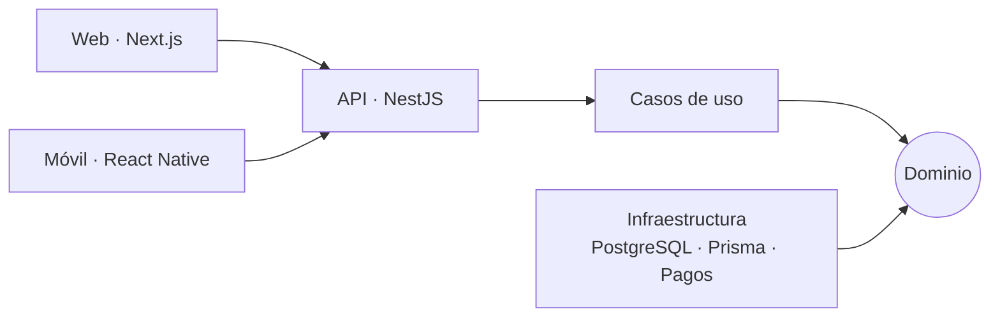

<div align="center">


<a href="https://github.com/SaintsLuis">
  
</a>

<br/>

<a href="https://santosvluis.vercel.app"></a>
<a href="https://www.linkedin.com/in/santosvluis/"></a>
<a href="mailto:santosvluism@gmail.com"></a>

<br/><br/>


</div>

---

## 👨‍💻 Sobre mí

```ts
const luis = {
  rol: "Ingeniero de Software Full-Stack",
  ubicacion: "Santo Domingo, República Dominicana 🇩🇴",
  idiomas: ["Español"],
  trabajoCon: ["Web", "Móvil", "SaaS"],
  principios: ["Clean Architecture", "DDD", "Código mantenible y probado"],
  abiertoA: "Oportunidades full-stack: remoto, híbrido o en Santo Domingo",
  siempre: "Aprendiendo tecnologías nuevas",
};
```

---

## 🛠️ Stack

<div align="center">


<br/>


</div>

---

## 🚀 Proyectos principales

> Despliega cada proyecto para ver más detalles 👇 · Más en mi [portafolio](https://santosvluis.vercel.app)

<details>
<summary><b>🏥 Medical Date</b> — plataforma médica completa (API + web + móvil)</summary>
<br/>

Los pacientes agendan citas desde el celular; médicos y secretarías gestionan citas, historiales, recetas y facturación, con permisos por rol.

- **Demo:** [medical-date-landing-page.vercel.app](https://medical-date-landing-page.vercel.app)
- **Código:** [frontend](https://github.com/SaintsLuis/medical-date_frontend) · [landing page](https://github.com/SaintsLuis/medical-date_landing-page)
- **Stack:** Next.js · React Native · NestJS · PostgreSQL · Prisma · Docker

</details>

<details>
<summary><b>💼 CarteraGo</b> — reemplaza el cuaderno de un prestamista</summary>
<br/>

Los cobradores registran pagos desde el celular, el dueño los ve al instante y el cierre diario cuadra automáticamente.

- **Demo:** [carterago.vercel.app](https://carterago.vercel.app)

</details>

<details>
<summary><b>🍽️ Brasa &amp; Co.</b> — kiosco de autoservicio para restaurantes</summary>
<br/>

El cliente pide, personaliza y paga en pantalla; la cocina recibe el pedido de inmediato. El servidor recalcula los precios, así que los totales no se pueden manipular desde el cliente.

- **Código:** [restaurant-kiosk](https://github.com/SaintsLuis/restaurant-kiosk)

</details>

<details>
<summary><b>🛍️ Teslo Shop</b> — tienda en línea de punta a punta</summary>
<br/>

Búsqueda, carrito, cuentas de usuario, pagos con PayPal y panel de administración para productos y pedidos.

- **Demo:** [teslo-shop-lms.vercel.app](https://teslo-shop-lms.vercel.app)

</details>

---

## 🧠 Cómo trabajo

Me gusta construir apps que sigan siendo fáciles de cambiar cuando crecen. Mi forma de pensarlas:

1. **Primero el negocio, después la tecnología.** Modelo el dominio (citas, pagos, cierres de caja) con DDD antes de elegir herramientas.
2. **Clean Architecture.** Las reglas del negocio no dependen del framework ni de la base de datos: las dependencias apuntan hacia adentro. Si cambia el proveedor de pagos o la base de datos, el núcleo no se reescribe.
3. **El servidor es la fuente de verdad.** Validaciones, permisos y cálculos (como los precios del kiosco) viven en el backend, no en el cliente.
4. **Un backend, varios clientes.** Una misma API alimenta el panel web y la app móvil, así las reglas no se duplican.
5. **SOLID y módulos pequeños.** Cada módulo hace una cosa, se puede probar solo y se puede crecer sin romper lo demás.
6. **Entornos reproducibles.** Docker y migraciones versionadas para que levantar el proyecto sea igual en cualquier máquina.



---

## 📊 Estadísticas de GitHub

<div align="center">


<br/>


</div>

---

<div align="center">

### 📫 ¿Hablamos?

Estoy abierto a oportunidades como desarrollador full-stack.
Escríbeme por [LinkedIn](https://www.linkedin.com/in/santosvluis/) o a [santosvluism@gmail.com](mailto:santosvluism@gmail.com).


</div>
