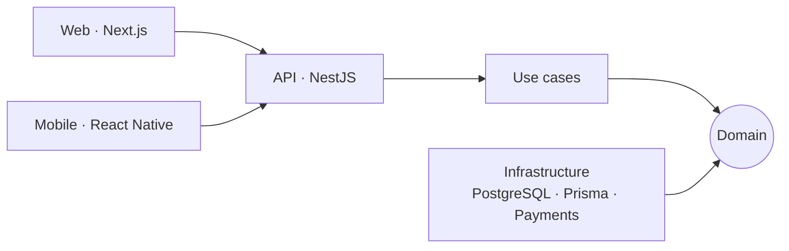

<div align="center">


<a href="https://github.com/SaintsLuis">
  
</a>

<br/>

<a href="https://santosvluis.vercel.app"></a>
<a href="https://www.linkedin.com/in/santosvluis/"></a>
<a href="mailto:santosvluism@gmail.com"></a>

<br/><br/>


</div>

---

## 👨‍💻 About me

```ts
const luis = {
  role: "Full-Stack Software Engineer",
  location: "Santo Domingo, Dominican Republic 🇩🇴",
  languages: ["Spanish", "English"],
  buildsWith: ["Web", "Mobile", "SaaS"],
  principles: ["Clean Architecture", "DDD", "Maintainable, well-tested code"],
  openTo: "Full-stack roles: remote, hybrid or in Santo Domingo",
  always: "Learning new technologies",
};
```

---

## 🛠️ Stack

<div align="center">


<br/>


</div>

---

## 🚀 Featured projects

> Expand each project to see screenshots and details 👇 · More work in my [portfolio](https://santosvluis.vercel.app)

<details open>
<summary><b>🏥 Medical Date</b> — complete medical platform (API + web + mobile)</summary>
<br/>

Patients book appointments from their phone; doctors and secretaries manage appointments, medical records, prescriptions and billing, with role-based permissions.


- **Live:** [medical-date-landing-page.vercel.app](https://medical-date-landing-page.vercel.app)
- **Code:** [frontend](https://github.com/SaintsLuis/medical-date_frontend) · [landing page](https://github.com/SaintsLuis/medical-date_landing-page)
- **Stack:** Next.js · React Native · NestJS · PostgreSQL · Prisma · Docker

</details>

<details>
<summary><b>💼 CarteraGo</b> — replaces a lender's paper ledger</summary>
<br/>

Collectors log payments from their phone, the owner sees them instantly, and daily closing balances automatically.


- **Live:** [carterago.vercel.app](https://carterago.vercel.app)

</details>

<details>
<summary><b>🍽️ Brasa &amp; Co.</b> — self-service kiosk for restaurants</summary>
<br/>

Customers order, customize and pay on screen, and the kitchen receives the order immediately. The server recalculates prices, so totals can't be tampered with from the client.


- **Code:** [restaurant-kiosk](https://github.com/SaintsLuis/restaurant-kiosk)

</details>

<details>
<summary><b>🛍️ Teslo Shop</b> — end-to-end online store</summary>
<br/>

Search, cart, user accounts, PayPal payments, and an admin panel for products and orders.


- **Live:** [teslo-shop-lms.vercel.app](https://teslo-shop-lms.vercel.app)

</details>

## 🧠 How I work

I like building apps that stay easy to change as they grow. This is how I approach them:

1. **Business first, technology second.** I model the domain (appointments, payments, daily closings) with DDD before choosing tools.
2. **Clean Architecture.** Business rules don't depend on the framework or the database: dependencies point inward. If the payment provider or the database changes, the core isn't rewritten.
3. **The server is the source of truth.** Validation, permissions and calculations (like the kiosk's prices) live in the backend, not in the client.
4. **One backend, many clients.** A single API feeds the web dashboard and the mobile app, so rules are never duplicated.
5. **SOLID and small modules.** Each module does one thing, can be tested on its own, and can grow without breaking the rest.
6. **Reproducible environments.** Docker and versioned migrations, so the project runs the same on any machine.



---

---

## 📊 GitHub stats

<!--START_STATS-->
<div align="center">

| 📦 Repos | ⭐ Stars | 👥 Followers | 🔥 Contributions (last year) | ⚡ Streak | 🏆 Best streak |
|:-:|:-:|:-:|:-:|:-:|:-:|
| **29** | **6** | **5** | **53** | **1 day** | **2 days** |

**Top languages:** TypeScript **73%** · JavaScript **10%** · HTML **5%** · C# **4%** · Astro **4%**

<sub>Updated automatically on 2026-11-01.</sub>

</div>
<!--END_STATS-->

---

<div align="center">

### 📫 Let's talk

I'm open to full-stack opportunities.
Reach me on [LinkedIn](https://www.linkedin.com/in/santosvluis/) or at [santosvluism@gmail.com](mailto:santosvluism@gmail.com).


</div>
